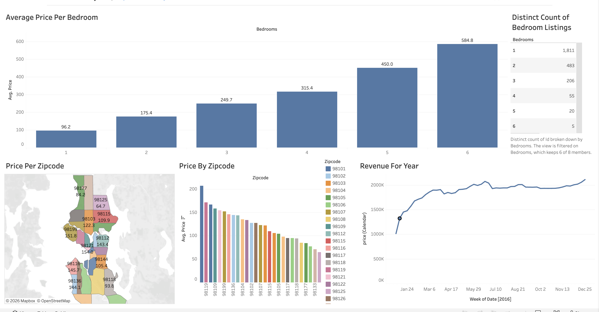

# Seattle Airbnb Dashboard (Tableau)

An interactive Tableau dashboard exploring Airbnb listings in Seattle: how price changes with property size, which zip codes are most expensive, and how nightly prices added up across 2016.

**[View the interactive dashboard on Tableau Public](https://public.tableau.com/app/profile/rajshree.ghimiray/viz/AirBnBFullProject_17776124480340/Dashboard1)**

## Questions explored

- How does the nightly price change as the number of bedrooms increases?
- How are listings spread across property sizes?
- Which Seattle zip codes have the highest and lowest average prices?
- How did calendar prices add up week by week across the year?

## Data

Public Seattle Airbnb data (2016), stored in an Excel workbook with two sheets:

- **Listings**: one row per property, with price, bedrooms and zip code
- **Calendar**: one row per listing per day, with the nightly price for that date

In Tableau I connected to the workbook and used an inner join on `Listings.id = Calendar.listing_id`, so every calendar day is matched to its property details. The data is stored as a Tableau extract.

## What I built

| Chart | Type | How it's built |
|---|---|---|
| Average Price Per Bedroom | Bar chart | Average listing price by bedroom count, with null and 0 bedroom values filtered out |
| Distinct Count of Bedroom Listings | Text table | Count of distinct listing IDs per bedroom count (1 to 6) |
| Price Per Zipcode | Filled map | Average price by zip code using Tableau's generated geography, labelled with zip and price |
| Price By Zipcode | Bar chart | Average price by zip code, sorted high to low, nulls removed |
| Revenue For Year | Line chart | Sum of Calendar price by week across 2016 |

All five sheets are combined in one dashboard.

## Key findings

- Price rises steadily with size, from about $96 a night for a 1 bedroom listing to about $585 for a 6 bedroom listing.
- The market is dominated by small properties. 1 bedroom listings (1,811) outnumber all larger listings combined.
- Prices vary considerably by location. The most expensive zip codes average more than double the cheapest ones.
- Weekly totals climb from around $1M in January to roughly $2M by mid-year, then stay fairly flat for the rest of the year.

## Limitations

The "revenue" line sums the nightly prices in the calendar table. In this dataset prices are generally recorded for nights that are listed as available, so the line is better read as potential revenue from open nights than as confirmed bookings.

## Tools

Excel (data storage), Tableau Public (joins, extracts, filters, filled maps, dashboard layout)
